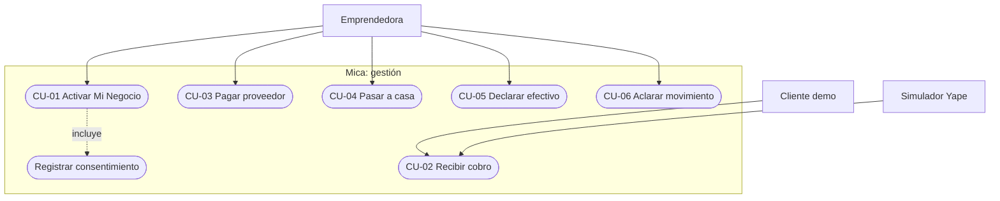
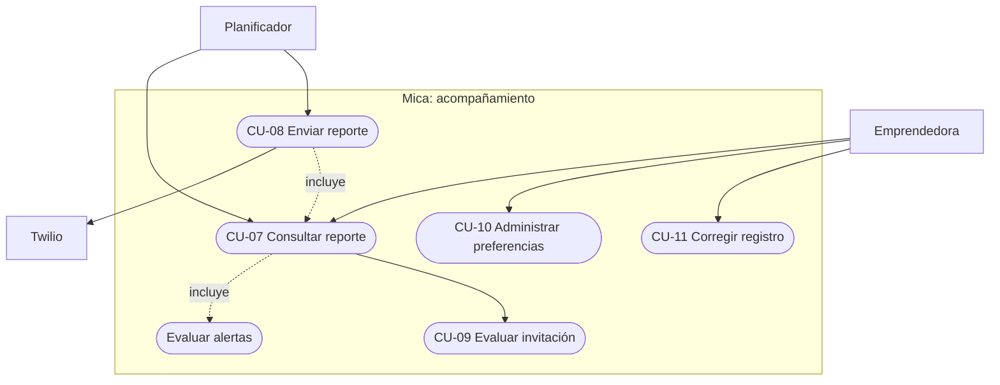
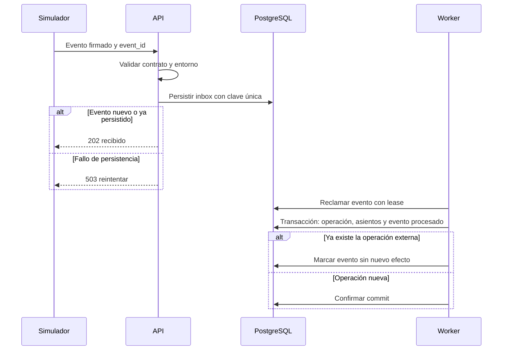
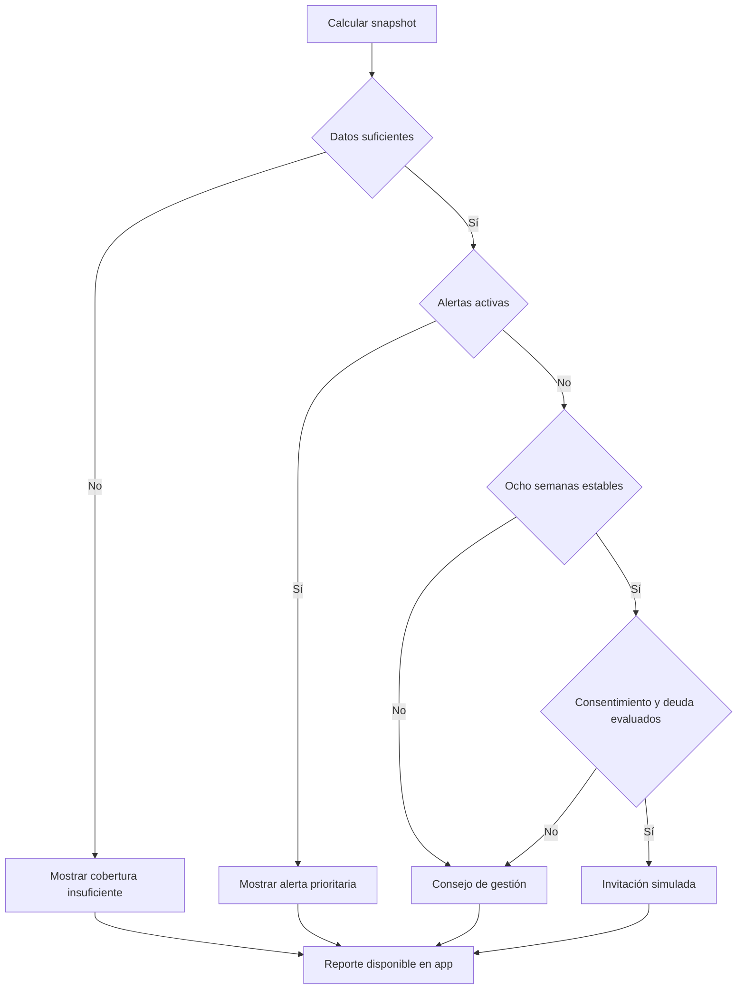
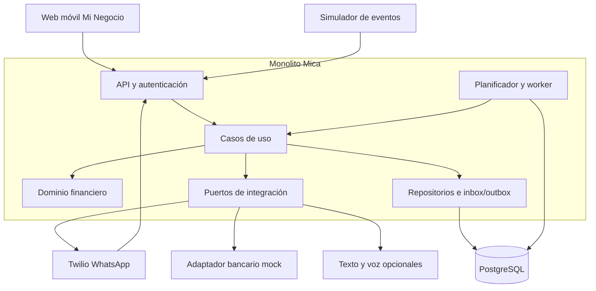
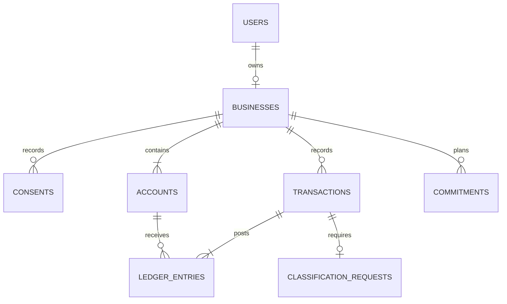
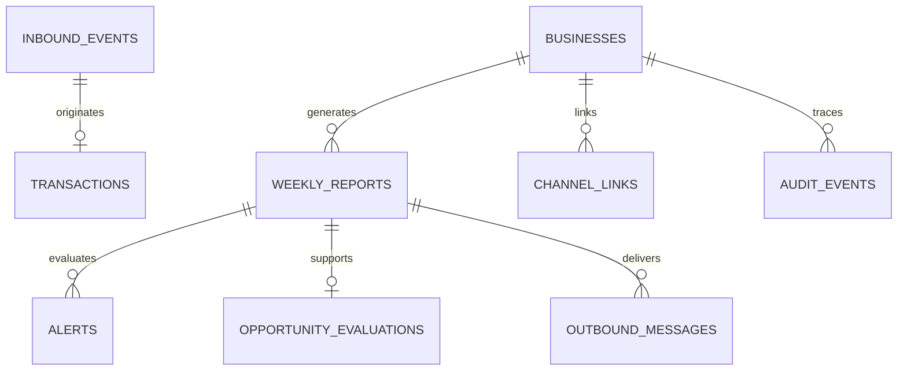

# Mica · Mi Negocio

> **Hackatón Women in Tech 2026 — UTEC Ventures / CIX BCP**  
> **Reto 2:** Crecimiento financiero para emprendedoras.  
> **Versión:** 2.0 · Especificación propuesta · 6 de noviembre de 2026.  
> **Arquitectura:** monolito modular con API REST, PostgreSQL y procesamiento durable.  
> **Estado:** documento de análisis y diseño; no certifica implementación, pruebas aprobadas ni convenios con Yape o BCP.

**Mica propone “Mi Negocio”, una función gratuita dentro de Yape que separa el dinero del negocio del dinero de la casa y convierte los movimientos en información semanal comprensible.** La experiencia se complementa con reportes por WhatsApp, concebidos para una futura integración y contenidos de Contigo Emprendedor.

En la hackatón, una interfaz móvil web representa la experiencia propuesta en Yape, las operaciones financieras son simuladas y Twilio permite demostrar el canal WhatsApp con teléfonos de prueba autorizados. La separación real de fondos requiere implementación y autorización del proveedor financiero.

**Decisión de precisión financiera:** con cobros y pagos se calcula flujo de caja registrado. Sin inventario, costo de ventas, obligaciones y otros ajustes, no se puede afirmar cuánto ganó realmente el negocio. El MVP dice “te quedó de tus cobros después de pagar el negocio”; no presenta ese importe como utilidad contable ni como capacidad de endeudamiento certificada.

> **Backend revisado el 7 de noviembre de 2026:** [instrucciones de ejecución](backend/README.md) y [auditoría con evidencia y pendientes](backend/AUDIT.md). La revisión técnica no acredita integración bancaria ni cierre de las dependencias externas.

## 1. Visión, problema y usuaria

### 1.1 Visión

Que una emprendedora pueda saber cuánto dinero tiene registrado para su negocio, cuánto retiró para su hogar y qué compromisos necesita cubrir, sin llevar una contabilidad manual diaria de sus cobros digitales. Ese historial puede, con autorización y validación posteriores, facilitar conversaciones sobre ahorro y financiamiento formal.

La propuesta ordena el recorrido así: **separar → observar → entender → anticipar → explorar productos pertinentes**. La gestión aporta valor incluso si la usuaria nunca solicita crédito.

### 1.2 Problema e hipótesis

Una microemprendedora cobra por Yape y en efectivo, compra mercadería y paga necesidades familiares con una misma caja. Sus anotaciones no siempre permiten cerrar la semana, distinguir retiros de gastos ni identificar el dinero comprometido para reponer inventario.

| Dolor | Consecuencia | Respuesta propuesta |
|---|---|---|
| Mezcla del dinero familiar y comercial | No distingue cuánto conserva el negocio | Bolsillos separados y retiros identificables |
| Registro incompleto o difícil de interpretar | Decide sin una visión del periodo | Captura automática de eventos digitales y resumen sencillo |
| Descapitalización al retirar dinero | Falta dinero para proveedores | Alertas explicables y próximos compromisos |
| Actividad difícil de acreditar | Menos información para una evaluación formal | Historial con procedencia y cobertura explícitas |
| Poco tiempo para aprender herramientas | Abandono del registro diario | Interacción breve y canales familiares |

**Hipótesis a validar:** la separación y un reporte útil mejoran la comprensión y continuidad de uso. El historial podría mejorar la información disponible para una evaluación financiera; no garantiza aprobación, mejores tasas ni reducción de mora.

### 1.3 Usuaria y escenario

**Rosa** es una persona ilustrativa, no una entrevistada identificada: tiene un negocio en marcha, vende desde su hogar o un pequeño local, cobra por Yape y efectivo, usa WhatsApp y anota algunas operaciones en un cuaderno. No necesita conocimientos contables para usar Mica.

El equipo reporta entrevistas que describen el uso de cuaderno sin claridad sobre resultados. No se adjuntaron transcripciones ni tamaño de muestra: esa evidencia debe documentarse antes de cuantificarla. Para el pitch, usar un testimonio real solo con autorización y anonimización adecuada.

### 1.4 Propuesta de valor y sostenibilidad

- **Para la emprendedora:** visibilidad de flujos, separación del hogar, menos registro manual de operaciones digitales y anticipación de faltantes.
- **Para el BCP, como hipótesis:** mejor contexto de actividad comercial, menor mezcla con transferencias familiares y oportunidades de acompañamiento pertinentes.
- **Financiamiento propuesto:** Mica es gratuita para la usuaria y financiada por el BCP. No existe un acuerdo acreditado en los archivos revisados. Twilio, infraestructura y soporte generan costos que deben medirse.
- **Diferenciación de diseño:** no es un cuaderno conversacional diario; la captura digital es el punto de partida y WhatsApp explica y aclara. Las comparaciones comerciales con otras soluciones necesitan fuentes vigentes.

## 2. Alcance del MVP

### 2.1 Entrega vertical mínima

Una usuaria activa Mi Negocio, recibe cobros simulados mediante un QR de demostración, paga un proveedor, pasa dinero a casa, declara efectivo y consulta un reporte calculado desde PostgreSQL. El mismo reporte puede enviarse por Twilio a un teléfono de prueba vinculado. Un escenario de riesgo suprime toda invitación financiera; un escenario estable muestra una invitación simulada y explicada.

| Capacidad | P0: obligatoria | P1: si P0 está estable | Posterior |
|---|---|---|---|
| Identidad | Sesión de demo aislada y vínculo verificado con WhatsApp de prueba | Recuperación de vínculo | Identidad autorizada del ecosistema bancario |
| Mi Negocio | Activación, consentimientos, QR demo y dos bolsillos virtuales | Personalización | Función dentro de Yape |
| Movimientos | Cobros, proveedor, retiro, aporte y efectivo declarado | Transferencia efectivo a digital simulada | Movimiento real de fondos y conciliación |
| Clasificación | Tipos explícitos y una aclaración por movimiento ambiguo | Ayuda por lenguaje natural | Clasificación enriquecida validada |
| Reporte | Flujo, retiros, comparación, consejo y alertas | Audio generado | Canal oficial |
| Productos | Elegibilidad ilustrativa con reglas determinísticas | Meta de ahorro simulada | Evaluación y contratación autorizadas |
| Formación | Recomendación de contenido curado por el equipo | Catálogo enlazado validado | Integración acordada con Contigo Emprendedor |
| Operación | Inbox/outbox, auditoría, pruebas y despliegue demo | Exportación del historial | Operación bancaria y soporte formal |

**P0 no exige IA generativa.** Plantillas determinísticas y botones resuelven la experiencia esencial. IA y voz son opcionales y no deben retrasar integridad financiera, separación o reportes.

### 2.2 Qué es real y qué se simula

| Elemento | Tratamiento en la hackatón |
|---|---|
| Interfaz “Mi Negocio” | Feature nueva de Yape |
| QR | Token opaco que abre un simulador de cobro; no es un QR cobrable de Yape |
| Saldos y pagos | Libro virtual persistido; sin dinero real |
| Datos semanales | Fixtures sintéticos con origen `SIMULATED`; incluso si imitan eventos bancarios |
| WhatsApp | Integración real de prueba por Twilio, si se configura y verifica |
| Mica | Experiencia conceptual del asistente |
| Invitaciones de ahorro/crédito | Tarjetas ilustrativas; no oferta, scoring ni aprobación |
| Semanas estables | Historial sintético precargado y claramente rotulado |

### 2.3 Fuera de alcance

Operar dinero real, solicitar claves de Yape, integrar APIs bancarias no habilitadas, emitir créditos, consultar centrales de riesgo, cobrar cuotas, contabilidad tributaria, inventario valorizado, utilidad exacta, OCR de cuadernos, registro obligatorio diario por chat, fiados, múltiples negocios por usuaria y múltiples monedas.

No se bloquea dinero por una alerta. Un retiro dentro del saldo disponible puede continuar tras una explicación; la usuaria mantiene el control. Los pagos digitales requieren conectividad y confirmación del servidor: el MVP no promete pagos offline.

## 3. Reglas de negocio y cálculos

### 3.1 Catálogo de reglas

| ID | Regla verificable |
|---|---|
| RN-01 | Activar Mi Negocio requiere consentimiento de tratamiento para las finalidades mostradas; el envío por WhatsApp y compartir con un banco son decisiones separadas. |
| RN-02 | Un negocio activo por usuaria en P0; moneda única `PEN`, importes positivos con hasta dos decimales. |
| RN-03 | Todo cobro confirmado por el QR demo pertenece al bolsillo negocio; un cobro pendiente no incrementa saldo. |
| RN-04 | El dinero recibido fuera del QR de negocio no se considera venta automáticamente. |
| RN-05 | Un pago a proveedor reduce el dinero del negocio y se clasifica como salida operativa; no demuestra por sí solo el costo de lo vendido. |
| RN-06 | “Pasar a mi casa” reduce negocio y aumenta hogar por el mismo importe, de forma atómica; es retiro, no gasto operativo. |
| RN-07 | Un aporte de casa a negocio aumenta negocio y reduce hogar; no se suma a ventas. |
| RN-08 | Una venta en efectivo incrementa únicamente la caja física declarada. No aumenta el bolsillo digital ni demuestra un depósito bancario. |
| RN-09 | Origen del movimiento y clasificación son distintos: un proveedor puede confirmar importe/fecha sin confirmar que la transacción sea una venta. |
| RN-10 | Ningún dato sintético se etiqueta como verificado; un dato digitado por la usuaria siempre es declarado. |
| RN-11 | Un movimiento ambiguo afecta el saldo si el evento confirma la salida, pero no se clasifica como gasto o retiro hasta resolverlo. El reporte muestra la incertidumbre. |
| RN-12 | No usar `float` para dinero; usar `Decimal` y `NUMERIC(14,2)`. Rechazar importes con más de dos decimales en entradas manuales. |
| RN-13 | Un mismo evento o comando no puede generar dos efectos financieros. Idempotencia en BD y comandos, no solo en memoria. |
| RN-14 | No editar ni borrar asientos confirmados; crear reversión compensatoria y reemplazo cuando corresponda. |
| RN-15 | Ningún retiro/pago iniciado por la usuaria supera el saldo del bolsillo de origen. Control bajo bloqueo transaccional. |
| RN-16 | Una operación con resultado externo incierto queda pendiente de conciliación; no asumir éxito o fracaso por timeout. |
| RN-17 | Un reporte tiene periodo, corte de datos, versión de reglas, cobertura y procedencia; la ausencia de registros no equivale a ausencia de ventas. |
| RN-18 | Mostrar como máximo un consejo y una alerta principal; conservar todas las alertas activas para las reglas internas. |
| RN-19 | Cualquier alerta activa, dato insuficiente o clasificación pendiente bloquea invitaciones de ahorro y crédito en P0. |
| RN-20 | Ocho semanas estables constituyen un umbral ilustrativo configurable, no una política del BCP ni garantía crediticia. |
| RN-21 | No sugerir crédito si hay uno activo o deuda desconocida en el escenario. En P0 este estado es sintético; no puede asumirse que el banco conoce todas las deudas. |
| RN-22 | Pausar el reporte no borra los movimientos ni cambia la propiedad del saldo; retirar consentimiento de uso de datos suspende las funciones dependientes. |
| RN-23 | Las cifras y decisiones provienen del motor determinístico. Un LLM nunca calcula saldos, autoriza pagos ni aprueba productos. |
| RN-24 | Los cambios de consentimiento se vuelven a comprobar justo antes de enviar o compartir; cancelar mensajes pendientes si ya no están autorizados. |

### 3.2 Procedencia y cobertura

Cada operación distingue:

- `source`: `SIMULATED`, `USER_DECLARED` o `PROVIDER_CONFIRMED`.
- `environment`: `DEMO` o `LIVE`; solo DEMO está previsto para la entrega.
- `classification_source`: `EXPLICIT_ACTION`, `USER_CONFIRMED`, `RULE` o `PENDING`.
- `external_transaction_id`, si lo proporciona una integración autenticada.

`PROVIDER_CONFIRMED` significaría que un proveedor autorizado confirmó la operación digital, **no** que certificó ventas, utilidad o la totalidad del negocio. En DEMO está prohibido usar ese origen. El reporte no mezcla datos demo y reales.

La cobertura se expresa con operaciones digitales, declaradas y pendientes, más una advertencia sobre efectivo no registrado. No calcular “porcentaje de ventas reales capturadas” porque no se conoce el denominador.

### 3.3 Fórmulas

Para un periodo `[inicio, fin)` y operaciones efectivas netas de sus reversiones:

| Símbolo | Definición |
|---|---|
| V | Ventas cobradas registradas, digitales y efectivo declarado |
| G | Pagos operativos registrados, incluyendo compras de mercadería |
| R | Retiros para casa |
| A | Aportes personales al negocio |
| F | Flujo operativo registrado: `V − G` |
| N | Variación registrada por operaciones clasificadas: `V − G − R + A` |
| D | Saldo digital negocio según asientos de esa cuenta |
| E | Saldo de efectivo declarado según asientos de esa cuenta |

`N` explica la variación total solo si no hay otros tipos, saldos iniciales o movimientos pendientes de clasificación. Los saldos siempre se calculan desde asientos, no desde una fórmula de ventas que ignore movimientos desconocidos. `D + E` es dinero registrado en dos medios distintos, no un saldo bancario único ni dinero enteramente disponible para pagar digitalmente.

**Utilidad contable:** no calculada en P0. Comprar S/800 de mercadería no significa haber consumido S/800 de inventario esa semana. Tampoco recibir un aporte de S/300 equivale a vender S/300.

**Comparación semanal:** `(V_actual − V_anterior) / V_anterior × 100`, únicamente si `V_anterior > 0` y ambos periodos están completos y tienen cobertura comparable. Si el denominador es cero o faltan datos, mostrar “sin base suficiente para comparar”.

### 3.4 Corte del reporte

- Zona de negocio: `America/Lima`; persistencia temporal: `TIMESTAMPTZ`.
- Semana completa: lunes 00:00 a lunes siguiente 00:00, extremo final excluido.
- Domingo 20:00: reporte preliminar de la semana hasta ese instante; no llamarlo cierre completo.
- Lunes 00:05: consolidar la semana terminada en la aplicación, sin mandar otro WhatsApp automáticamente.
- Al comparar el preliminar del domingo, usar el mismo tramo de la semana previa. Las reglas de estabilidad usan exclusivamente semanas completas.
- Un evento recibido tarde genera una nueva revisión del reporte del periodo afectado. Conservar el anterior y no reenviar automáticamente un mensaje corregido.

### 3.5 Tres alertas, con parámetros ilustrativos

| Código | Activación | Requisitos de datos | Mensaje y tratamiento |
|---|---|---|---|
| `EXCESS_WITHDRAWAL` | `R > max(F, 0)` | Periodo sin clasificaciones pendientes; de lo contrario avisar que no se puede evaluar | “Sacaste más de lo que quedó de tus cobros después de pagar el negocio”. No afirmar que retiró más que su utilidad. |
| `SALES_DROP` | `V_actual < promedio_4_previas × 0.70` | Cuatro periodos comparables completos, promedio positivo y sin fallos de captura conocidos | “Tus cobros registrados bajaron frente a tu promedio”. El 30% es parámetro de demo, no umbral validado. |
| `PAYMENT_SHORTFALL` | `saldo_del_medio < compromisos_en_7_días_del_mismo_medio` | Compromisos explícitos confirmados y medio de pago definido | Informar fecha, importe y faltante. No descontar efectivo de un pago digital como si ya estuviera depositado. |

Prioridad de presentación: faltante próximo → retiros → caída de ventas. Resolver una alerta requiere reevaluar sus datos; ocultarla o leerla no la resuelve.

P0 permite registrar un compromiso de proveedor con importe y fecha, o precargarlo en una fixture. Inferir recurrencia automáticamente queda en P1: el sistema debe preguntar y confirmar antes de tratar una repetición como obligación cierta.

### 3.6 Estabilidad e invitaciones simuladas

Una semana cuenta como estable si está completa, tiene captura sin errores conocidos, al menos un cobro, `F > 0`, no tiene movimientos ambiguos y no presenta ninguna de las tres alertas. Son criterios de demostración, no validación bancaria.

Para mostrar una invitación simulada: ocho semanas consecutivas estables, ninguna alerta actual, consentimiento de invitaciones y datos suficientes. Para crédito, además, deuda del escenario conocida y sin crédito activo.

Como restricción ilustrativa de una **cuota semanal**:

`cuota_demo ≤ 0.20 × min(F de las últimas 8 semanas completas)`

Todos los valores deben ser positivos. El parámetro 20% y el periodo semanal son de demo. No convertirlos en una tasa, monto de préstamo o regla real de capacidad de pago. El flujo registrado puede omitir necesidades del hogar y otras deudas: una entidad tendría que evaluar esas obligaciones, costos del crédito y condiciones antes de ofrecerlo.

Si no se cumplen los criterios: seguir mostrando gestión y contenido educativo, sin llamada a endeudarse. Una invitación a ahorrar tampoco debe ignorar faltantes de liquidez.

### 3.7 Ejemplo numérico reproducible

Escenario sintético con saldo inicial cero:

| Operación | Digital negocio | Efectivo declarado | Hogar | Tipo |
|---|---:|---:|---:|---|
| Cobros por QR | +1 200 | 0 | 0 | Venta simulada |
| Ventas en efectivo | 0 | +300 | 0 | Venta declarada en entorno demo |
| Pago proveedor digital | −800 | 0 | 0 | Salida operativa |
| Pasar a casa | −600 | 0 | +600 | Retiro; requiere aporte previo indicado abajo |
| Aporte desde hogar | +300 | 0 | −300 | Aporte, no venta |

**Orden de ejecución:** inicializar hogar con S/300 mediante asiento de apertura, recibir cobros, pagar proveedor, aportar S/300 y finalmente retirar S/600. Así no existe sobregiro intermedio.

Resultados: `V=1500`, `G=800`, `F=700`, `R=600`, `A=300`, `N=400`, `D=100`, `E=300`, hogar final S/600. La apertura de hogar no es una venta. Si el proveedor requiere S/1 500 digitales el lunes, el faltante digital es S/1 400; no S/1 100. No hay alerta por retiros excesivos en este ejemplo, pero sí por compromiso próximo.

Ejemplo de reporte: “Registraste S/1 500 en cobros: S/1 200 digitales y S/300 en efectivo declarado. Pagaste S/800 al negocio y pasaste S/600 a casa. De tus cobros quedaron S/700 después de esos pagos del negocio; esto no es tu ganancia exacta. Tienes S/100 digitales en el negocio. Para tu pago de S/1 500 del lunes faltan S/1 400 digitales”. En la interfaz dividirlo en cuatro bloques breves.

## 4. Requerimientos funcionales

Prioridad: **P0** entrega mínima, **P1** mejora, **F** integración futura. Los identificadores enlazan reglas, casos y pruebas.

| ID | Requerimiento | Prioridad | Verificación observable |
|---|---|---|---|
| RF-01 | Crear sesión de demo aislada y vincular teléfono por código de un solo uso | P0 | Otra sesión no consulta sus datos; código expira y no se reutiliza |
| RF-02 | Activar/desactivar Mi Negocio y registrar consentimientos separados | P0 | Finalidad, versión, fecha y revocación auditadas |
| RF-03 | Emitir QR demo con token revocable | P0 | Abre simulador rotulado; no expone teléfono ni IDs sensibles |
| RF-04 | Ingerir cobros simulados confirmados de forma idempotente | P0 | Un evento repetido produce una venta |
| RF-05 | Consultar saldo digital de negocio, hogar y efectivo declarado | P0 | Valores separados y derivados de asientos |
| RF-06 | Simular pago al proveedor y registrar compromiso próximo | P0 | Pago atómico; compromiso tiene importe, medio y vencimiento |
| RF-07 | Pasar a casa y aportar al negocio | P0 | Dos cuentas actualizadas atómicamente; sin alterar ventas |
| RF-08 | Registrar venta/gasto en efectivo declarado | P0 | Afecta solo caja física y exhibe procedencia |
| RF-09 | Resolver clasificación ambigua | P0 | Una respuesta válida actualiza la clasificación auditada sin duplicar importe |
| RF-10 | Consultar historial filtrado y corregir movimientos permitidos | P0 | Paginación y reversión/reemplazo trazables |
| RF-11 | Generar reporte preliminar y cierre semanal versionados | P0 | Totales reproducibles para un corte definido |
| RF-12 | Evaluar tres alertas y elegir un consejo concreto | P0 | Explicación con datos; regla versionada |
| RF-13 | Enviar reporte por Twilio y consultar estado de entrega | P0 | Inbox/outbox persistidos y recibo del proveedor |
| RF-14 | Pausar/reanudar mensajes y revocar finalidades | P0 | Mensajes pendientes cancelados según consentimiento |
| RF-15 | Evaluar invitación ilustrativa de ahorro/crédito | P0 | Alerta o datos insuficientes bloquean invitación |
| RF-16 | Registrar eventos de uso sin contenido financiero en analítica | P0 | Métricas por cohorte y entorno, sin mezclar demo con personas reales |
| RF-17 | Ofrecer contenido educativo curado pertinente | P0 | Recomendación breve, con enlace solo si el equipo lo verifica |
| RF-18 | Generar audio del mismo reporte aprobado | P1 | Mismas cifras; alternativa de texto siempre disponible |
| RF-19 | Exportar historial con procedencia y cobertura | P1 | Archivo marcado como no certificación bancaria |
| RF-20 | Consumir eventos reales de Yape y canal Salvador oficial | F | Acuerdo, contrato y pruebas con proveedor autorizados |

## 5. Requerimientos no funcionales

Son **objetivos a medir**, no resultados alcanzados. Referencia de carga de demo: 20 sesiones concurrentes, 10 000 movimientos sintéticos y una instancia de aplicación con PostgreSQL.

| ID | Atributo | Criterio propuesto y medición |
|---|---|---|
| RNF-01 | Integridad | Cero efectos financieros duplicados en pruebas de reentrega y concurrencia; asientos balanceados en cada operación |
| RNF-02 | Autorización | Cada consulta/comando filtra por negocio de la sesión; pruebas cruzadas de todas las rutas protegidas |
| RNF-03 | Seguridad de canal | HTTPS; firma Twilio validada con SDK; credenciales fuera del cliente y del repositorio |
| RNF-04 | Rendimiento API | p95 menor a 500 ms para lecturas locales bajo carga de referencia; registrar equipo y configuración de medición |
| RNF-05 | Webhooks | p95 menor a 2 s hasta confirmar persistencia; no esperar generación de texto/audio |
| RNF-06 | Reportes | p95 menor a 5 s para cálculo de una usuaria con 10 000 movimientos; entrega externa medida por separado |
| RNF-07 | Recuperación | Reiniciar el proceso y recuperar jobs persistidos; no perder eventos ya confirmados por HTTP 2xx |
| RNF-08 | Accesibilidad | Interfaz usable a 360 px, teclado, etiquetas, contraste legible; objetivos WCAG 2.2 AA a evaluar, sin declarar certificación |
| RNF-09 | Comprensión | En testeo, la usuaria distingue saldo digital, efectivo y retiro; registrar porcentaje y muestra |
| RNF-10 | Baja conectividad | Consultas muestran última actualización; reintentar lectura y conservar borradores no sensibles; nunca mostrar pago exitoso sin confirmación |
| RNF-11 | Observabilidad | Correlation ID, latencia, errores, jobs atrasados y reintentos; logs sin teléfonos completos, tokens ni texto financiero |
| RNF-12 | Mantenibilidad | Dominio sin dependencia de FastAPI/Twilio; contratos versionados y migraciones repetibles |
| RNF-13 | Despliegue | Demo pública disponible al menos 30 días posteriores al evento, conforme a bases; monitoreo y responsable asignados |
| RNF-14 | Privacidad | Datos sintéticos por defecto, permisos mínimos, revocación comprobada; retención de datos reales definida antes de piloto |
| RNF-15 | Recuperación de BD | Backup de demo diario; objetivo RPO 24 h y RTO 2 h, verificado mediante restauración en entorno separado |
| RNF-16 | Costos | Medir costo por reporte entregado y limitar envíos por sesión; audio e IA desactivables |

## 6. Casos de uso y diagramas

### 6.1 Actores

| Actor | Responsabilidad |
|---|---|
| Emprendedora | Activa, autoriza, consulta, paga, retira, declara efectivo y aclara |
| Simulador de Yape | Emite eventos sintéticos; sustituible por adaptador autorizado |
| Cliente demo | Abre QR y simula cobro dentro del escenario aislado |
| Planificador | Solicita reportes para periodos/cortes determinados |
| Twilio / WhatsApp | Transporta mensajes de prueba y estados |
| Operador de demo | Precarga escenarios sintéticos; no accede a datos reales por defecto |

### 6.2 Diagramas de casos de uso

Mermaid no ofrece una notación UML nativa de casos de uso en este documento. Se usan diagramas de asociación con óvalos y límite del sistema; las flechas “incluye” representan comportamiento requerido y las ramas condicionadas se detallan en los flujos.





### 6.3 Especificación de casos

| Caso | Precondiciones y disparador | Flujo principal | Alternativas y postcondición |
|---|---|---|---|
| CU-01 Activar | Sesión válida; pulsa “Activar” | Explicar finalidades → aceptar tratamiento → crear negocio y cuentas → emitir QR → ofrecer vínculo WhatsApp opcional | Si rechaza, no activar. Reintento devuelve el mismo negocio. Mensajería desactivada hasta consentimiento y vínculo. RF-01–03 |
| CU-02 Cobrar | Negocio activo, QR demo válido | Validar evento → persistir inbox → confirmar unicidad → crear operación y asientos → actualizar consulta | Evento duplicado no cambia saldo; pendiente no se contabiliza; origen siempre simulado. RF-04–05 |
| CU-03 Proveedor | Saldo digital suficiente; importe y destino explícitos | Mostrar resumen → confirmar → bloquear cuenta → registrar salida → generar recibo demo | Saldo insuficiente rechaza; doble clic devuelve resultado original; compromiso queda pagado solo si se vincula la operación. RF-06 |
| CU-04 Pasar a casa | Negocio activo; saldo suficiente | Elegir monto → informar alerta si aplica → confirmar → asientos negocio/hogar en una transacción | Cancelar no mueve saldo. Alerta no retiene fondos. Concurrencia se resuelve en BD. RF-07 |
| CU-05 Efectivo | Negocio activo; origen físico explícito | Elegir venta/gasto → ingresar importe/fecha → confirmar → registrar como declarado | No tocar cuenta digital. Gasto mayor a caja declarada pide registrar/aprobar apertura faltante, nunca inventarla. RF-08 |
| CU-06 Aclarar | Movimiento con categoría pendiente | Mostrar importe/fecha → elegir proveedor/casa/otra → validar pertenencia y vigencia → actualizar clasificación y auditoría | Respuesta vencida exige nueva consulta; respuesta repetida no duplica. No añadir un segundo movimiento de caja. RF-09 |
| CU-07 Reporte | Sesión propietaria o job autorizado | Definir corte → sumar asientos y categorías → evaluar calidad/alertas → guardar snapshot → mostrar cuatro bloques | Sin datos: no inventar comparación; cobertura incompleta inhibe invitaciones; corrección crea revisión. RF-11–12 |
| CU-08 WhatsApp | Vínculo, consentimiento y canal habilitados | Generar snapshot → crear outbox única → comprobar consentimiento/ventana → enviar → registrar SID y estados | Sin ventana/plantilla válida, conservar reporte en app y marcar envío bloqueado; timeout de envío no implica reenvío automático. RF-13 |
| CU-09 Invitación | Evaluación solicitada desde reporte | Revisar datos, alertas y 8 semanas → aplicar reglas → devolver elegible/no elegible y razones | Datos insuficientes o deuda desconocida bloquean crédito. Elegible solo muestra exploración simulada. RF-15 |
| CU-10 Preferencias | Identidad autenticada o teléfono previamente vinculado | Pausar mensajes, cambiar formato o revocar finalidad → auditar → cancelar pendientes relacionados | “No mensajes” no vacía cuentas. Compartir con banco sigue siendo opt-in separado. RF-14 |
| CU-11 Corregir | Movimiento permitido y de la propietaria | Mostrar impacto → confirmar → crear reversión y reemplazo atómicos → versionar reportes | Movimiento de proveedor real no se modifica por declaración. Reversión repetida no vuelve a sumar. RF-10 |

### 6.4 Secuencia de cobro



### 6.5 Decisión del reporte



## 7. Arquitectura monolítica

### 7.1 Decisión

Un **monolito modular** concentra dominio, API, planificador y procesamiento en un repositorio y una versión desplegable. PostgreSQL es la única base transaccional. No hay microservicios ni comunicación HTTP entre módulos internos.

La API y el worker pueden ser dos procesos de la **misma imagen y release**, con la misma base de datos y lógica. Separar el proceso de trabajo mejora la recuperación y evita que un envío lento bloquee HTTP; no convierte los módulos en servicios independientes. Para una demo mínima también pueden convivir en un proceso, manteniendo siempre los jobs en BD.



El frontend se compila y puede servirse como archivos estáticos desde el mismo despliegue. En desarrollo, Vite corre por separado; eso no introduce otro backend de negocio.

### 7.2 Consistencia y recuperación

1. Validar autenticación/firma y contrato antes de aceptar un evento.
2. Guardar el evento en inbox antes de devolver 2xx. Si falla la BD, devolver error recuperable.
3. Reclamar jobs con bloqueo SQL y lease temporal. Un worker caído deja trabajo recuperable cuando vence el lease.
4. En una transacción: verificar unicidad, bloquear cuentas afectadas en orden estable, validar saldo, crear operación/asientos/auditoría y marcar el evento procesado.
5. Crear outbox en la misma transacción cuando deba producirse un efecto de comunicación.
6. Procesar outbox fuera de esa transacción. No mantener bloqueos financieros mientras se llama a Twilio.
7. Reintentar fallos transitorios con backoff de 5 s, 30 s, 2 min, 10 min y 30 min; después marcar `DEAD` y hacer visible el fallo al operador.

Objetivo: procesamiento **al menos una vez** con efecto financiero idempotente. No prometer entrega exactamente una vez en WhatsApp. Si una petición de envío termina en timeout después de que Twilio pudo aceptarla, marcar `UNKNOWN`, investigar SID/callbacks y evitar reenvío ciego.

`BackgroundTasks` puede ayudar con tareas pequeñas, pero no será la única persistencia de los trabajos críticos. La elección de inbox/outbox es una decisión de arquitectura de Mica.

### 7.3 Scheduler y reportes únicos

El scheduler recorre negocios activos y crea un job con clave `business_id + period_start + cutoff_at + kind`. Restricción única y bloqueo evitan duplicados aunque haya dos procesos. El worker vuelve a comprobar consentimiento, entorno y estado del reporte antes de encolar mensajes.

La consulta de snapshot usa una vista consistente de BD; guardar `data_cutoff_at`, `generated_at`, revisión y versión de reglas para reproducibilidad. Un reporte histórico no cambia silenciosamente al consultar.

## 8. Capas y responsabilidades

| Capa | Responsabilidades | No debe hacer |
|---|---|---|
| Presentación | Pantallas, validación de UX, formato `S/`, estados pendiente/error | Calcular saldo oficial, guardar secretos o decidir crédito |
| Entrada HTTP | Rutas, DTO, autenticación, validación de firma, errores | Incluir reglas financieras extensas |
| Aplicación | Ejecutar casos de uso, unidad de trabajo, idempotencia, autorización por negocio | Depender directamente de un SDK externo |
| Dominio | Money, operaciones, reglas de alerta, estabilidad y balance | Importar FastAPI, ORM, Twilio o un LLM |
| Infraestructura | PostgreSQL, repositorios, reloj, firmas, Twilio, scheduler y mocks | Inventar clasificación o reglas comerciales |
| Composición | Construir dependencias, cargar configuración, seleccionar adaptadores | Dispersar decisiones de entorno entre módulos |

Dependencias: entrada → aplicación → dominio. Infraestructura implementa interfaces definidas por aplicación/dominio. El dominio se prueba con datos en memoria; la integridad SQL se prueba contra PostgreSQL real de pruebas.

## 9. Módulos del backend

| Módulo | Componentes y responsabilidad | Datos propios / interfaz |
|---|---|---|
| `identity` | Sesiones demo, autorización, enlace de teléfono con nonce | users, sessions, channel_links |
| `business` | Activación, negocio, QR revocable | businesses, qr_tokens |
| `consents` | Finalidades, evidencia, revocación y preferencias | consents, preferences |
| `ledger` | Cuentas, operaciones, asientos, saldos, reversiones | accounts, transactions, ledger_entries |
| `classification` | Aclaraciones pendientes y resolución | classification_requests, audit_events |
| `commitments` | Pagos próximos confirmados y estado de cumplimiento | commitments |
| `insights` | Agregados, snapshots, comparaciones y calidad | weekly_reports, weekly_facts |
| `alerts` | Tres reglas y ciclo de vida de alertas | alerts |
| `opportunities` | Elegibilidad ilustrativa y motivos de exclusión | opportunity_evaluations |
| `messaging` | Inbox/outbox, vinculación de conversación, entrega | inbound_events, outbound_messages |
| `education` | Selección determinística de consejo/contenido | Catálogo versionado en código en P0 |
| `audit` | Registro transversal de actor, acción y motivo | audit_events |
| `demo` | Fixtures, reloj controlado y reset por sesión | Solo habilitado en DEMO |

Los módulos interactúan por servicios de aplicación y tipos explícitos. Por ejemplo, `opportunities` consume un snapshot de `insights` y resultados de `alerts`; no recalcula saldos con SQL independiente ni consulta Twilio. Se permite una transacción compartida cuando el caso de uso lo requiere.

## 10. Modelo de datos

### 10.1 Convenciones

- PK: UUID; FK explícitas; `business_id` en tablas de negocio.
- Fechas: `TIMESTAMPTZ`; dinero: `NUMERIC(14,2)` y moneda `CHAR(3)` restringida a PEN.
- Campos obligatorios salvo indicación `?`; `created_at` en todas las tablas; `updated_at` solo en entidades mutables.
- Strings de estado con `CHECK` o enums PostgreSQL; payload flexible en JSONB con validación de esquema en aplicación.
- No usar cascada de borrado sobre el libro financiero. El tratamiento de eliminación/anonimización y retención debe definirse antes de usar datos reales.
- FK compuestas `(business_id, entity_id)` para impedir referencias entre negocios; índices únicos equivalentes en entidades destino.

### 10.2 Diagrama entidad–relación: núcleo



### 10.3 Diagrama entidad–relación: reportes e integración



Los diagramas muestran relaciones principales; el diccionario siguiente es la referencia completa para implementación.

### 10.4 Identidad, negocio y autorización

| Tabla | Campos específicos | Restricciones y propósito |
|---|---|---|
| `users` | `id`, `display_name`, `status`, `environment` | No pedir DNI ni credenciales bancarias en demo |
| `sessions` | `id`, `user_id`, `token_hash`, `expires_at`, `revoked_at?` | Token aleatorio, solo hash en BD; sesión expirada no autoriza |
| `businesses` | `id`, `owner_id`, `name`, `category?`, `status`, `timezone`, `currency`, `environment` | UNIQUE owner_id en P0; estado ACTIVE/PAUSED/CLOSED |
| `channel_links` | `id`, `business_id`, `provider`, `phone_encrypted`, `phone_lookup_hash`, `verified_at?`, `last_inbound_at?`, `status` | Teléfono normalizado E.164; vínculo único activo por proveedor/teléfono en un entorno |
| `link_challenges` | `id`, `session_id`, `code_hash`, `expires_at`, `consumed_at?`, `attempts` | Código 10 min; máximo 5 intentos; un solo uso |
| `consents` | `id`, `business_id`, `purpose`, `policy_version`, `granted_at`, `revoked_at?`, `channel`, `evidence_ref` | Historial append-only salvo marca de revocación; una concesión activa por finalidad |
| `preferences` | `business_id` PK/FK, `reports_enabled`, `format`, `schedule_local`, `invitations_enabled` | TEXT por defecto; consentimiento sigue siendo necesario aunque esté enabled |
| `qr_tokens` | `id`, `business_id`, `token_hash`, `expires_at?`, `revoked_at?` | UNIQUE token_hash; nunca encodear teléfono en QR |

Finalidades propuestas: `CORE_PROCESSING`, `WHATSAPP_REPORTS`, `PRODUCT_INVITATIONS`, `BANK_SHARING`. El MVP no implementa compartir con un banco, aunque puede demostrar la elección sin efectuar transmisión.

### 10.5 Libro de movimientos

| Tabla | Campos específicos | Restricciones |
|---|---|---|
| `accounts` | `id`, `business_id`, `kind`, `currency` | UNIQUE business_id/kind; BUSINESS_DIGITAL, HOUSEHOLD_DIGITAL, CASH_DECLARED, EXTERNAL_CLEARING |
| `transactions` | `id`, `business_id`, `kind`, `amount`, `currency`, `status`, `source`, `environment`, `classification_source`, `occurred_at`, `confirmed_at?`, `provider?`, `external_transaction_id?`, `inbound_event_id?`, `reversal_of?`, `replacement_for?`, `adjustment_of?`, `idempotency_key?`, `description?` | amount > 0; POSTED tiene asientos; PENDING/FAILED no. UNIQUE proveedor/entorno/external_transaction_id cuando exista; UNIQUE reversal_of cuando no nulo |
| `ledger_entries` | `id`, `business_id`, `transaction_id`, `account_id`, `delta` | delta distinto de cero; suma por transacción = 0; moneda y negocio consistentes |
| `classification_requests` | `id`, `business_id`, `transaction_id`, `status`, `options`, `expires_at`, `resolved_at?`, `resolved_by?` | UNIQUE transaction_id; OPEN/RESOLVED/EXPIRED |
| `commitments` | `id`, `business_id`, `label`, `amount`, `payment_account_id`, `due_at`, `source`, `confirmed_at`, `status`, `paid_transaction_id?` | amount > 0; OPEN/PAID/CANCELLED; en P0 un pago completo por compromiso |
| `idempotency_records` | `id`, `business_id`, `route`, `key`, `request_hash`, `response_status`, `response_body`, `expires_at` | UNIQUE business_id/route/key; retención demo 7 días |

Tipos de operación: `SALE`, `BUSINESS_PAYMENT`, `HOUSEHOLD_WITHDRAWAL`, `OWNER_CONTRIBUTION`, `UNKNOWN_OUTFLOW`, `OPENING_BALANCE`, `CLASSIFICATION_ADJUSTMENT`, `REVERSAL`. CLASSIFICATION_ADJUSTMENT referencia `adjustment_of` y no entra como venta, gasto o retiro independiente; la categoría final de la operación original determina esas métricas. Una reversión invierte exactamente los asientos originales y cualquier ajuste de clasificación asociado, en una sola transacción; para métricas hereda la categoría de la operación revertida con signo inverso. No contar REVERSAL como una categoría de venta nueva.

**Libro balanceado simplificado:** `delta` expresa cambio en una cuenta virtual. `EXTERNAL_CLEARING` actúa como contrapartida de entradas/salidas externas y no se muestra como dinero disponible. Es un mecanismo de integridad de la demo, no un plan contable bancario completo.

| Operación de S/100 | Asientos |
|---|---|
| Cobro digital | BUSINESS_DIGITAL +100; EXTERNAL_CLEARING −100 |
| Pago proveedor | BUSINESS_DIGITAL −100; EXTERNAL_CLEARING +100 |
| Pasar a casa | BUSINESS_DIGITAL −100; HOUSEHOLD_DIGITAL +100 |
| Aporte desde casa | HOUSEHOLD_DIGITAL −100; BUSINESS_DIGITAL +100 |
| Venta en efectivo | CASH_DECLARED +100; EXTERNAL_CLEARING −100 |
| Gasto en efectivo | CASH_DECLARED −100; EXTERNAL_CLEARING +100 |
| Saldo inicial de hogar | HOUSEHOLD_DIGITAL +100; EXTERNAL_CLEARING −100; no venta |

Una salida ambigua se registra inicialmente contra EXTERNAL_CLEARING. Si luego se confirma que fue a casa, reclasificar mediante un ajuste balanceado que mueva la contrapartida a HOUSEHOLD_DIGITAL, sin volver a reducir BUSINESS_DIGITAL. Guardar ese ajuste ligado a la operación original y excluirlo de ventas/gastos independientes. Si solo cambia de UNKNOWN a BUSINESS_PAYMENT, basta reclasificación auditada sin nuevos asientos. La implementación debe distinguir ajustes de clasificación de operaciones monetarias nuevas.

### 10.6 Reportes, decisiones y mensajería

| Tabla | Campos específicos | Restricciones / política |
|---|---|---|
| `weekly_facts` | `id`, `business_id`, `week_start`, `revision`, `sales`, `payments`, `withdrawals`, `contributions`, `operating_flow`, `coverage_status`, `stable`, `rules_version`, `data_cutoff_at` | UNIQUE negocio/semana/revisión; solo semanas completas para estabilidad |
| `weekly_reports` | `id`, `business_id`, `period_start`, `period_end`, `data_cutoff_at`, `kind`, `revision`, `metrics_json`, `coverage_json`, `advice_code`, `text`, `rules_version`, `generated_at` | UNIQUE negocio/inicio/corte/kind/revisión; snapshots inmutables |
| `alerts` | `id`, `business_id`, `report_id`, `code`, `severity`, `evidence_json`, `status`, `resolved_at?` | UNIQUE report_id/code; no perder alertas secundarias |
| `opportunity_evaluations` | `id`, `business_id`, `report_id`, `eligible`, `product_type?`, `reasons_json`, `stable_weeks`, `demo_debt_status`, `weekly_installment_cap?`, `rules_version` | UNIQUE report_id; `is_simulated=true` obligatorio en P0 |
| `inbound_events` | `id`, `provider`, `environment`, `event_id`, `business_id?`, `payload_json`, `payload_hash`, `status`, `attempts`, `next_attempt_at?`, `locked_until?`, `received_at`, `processed_at?`, `error_code?` | UNIQUE provider/environment/event_id; payload con retención mínima |
| `outbound_messages` | `id`, `business_id`, `report_id?`, `channel_link_id`, `dedupe_key`, `body`, `status`, `provider_sid?`, `attempts`, `next_attempt_at?`, `locked_until?`, `error_code?`, `accepted_at?`, `delivered_at?` | UNIQUE dedupe_key; SID único cuando exista |
| `delivery_events` | `id`, `message_id`, `provider_sid`, `status`, `provider_time?`, `received_at`, `payload_hash` | Deduplicar por SID/status/hash; conservar callbacks fuera de orden |
| `scheduled_jobs` | `id`, `business_id`, `kind`, `dedupe_key`, `payload_json`, `status`, `run_at`, `locked_until?`, `attempts` | UNIQUE dedupe_key |
| `audit_events` | `id`, `business_id?`, `actor_type`, `actor_id?`, `action`, `entity_type`, `entity_id`, `reason?`, `metadata_json`, `correlation_id`, `occurred_at` | Append-only; sin secretos ni copias innecesarias de mensajes |

Estados de inbox/jobs: `PENDING`, `PROCESSING`, `DONE`, `RETRY`, `DEAD`. Estados salientes: `PENDING`, `SENDING`, `ACCEPTED`, `DELIVERED`, `FAILED`, `BLOCKED`, `CANCELLED`, `UNKNOWN`. “Aceptado” por API no significa “entregado”. Los callbacks tardíos no pueden degradar DELIVERED a ACCEPTED.

### 10.7 Invariantes SQL e índices

- Saldo de una cuenta = suma de sus asientos confirmados, incluyendo apertura y reversiones.
- Validar que la suma de `delta` sea cero mediante constraint trigger diferido al commit o procedimiento de publicación único; un `CHECK` de una fila no valida sumas entre filas.
- Revocar a la aplicación operaciones UPDATE/DELETE arbitrarias sobre asientos; publicar mediante la unidad de trabajo controlada.
- Para retiros, bloquear filas de cuentas con `SELECT ... FOR UPDATE`, recalcular saldo y publicar bajo la misma transacción. Todas las mutaciones de esas cuentas deben respetar ese protocolo.
- No aplicar la regla de saldo insuficiente para descartar silenciosamente un evento externo confirmado en una futura integración: persistir, conciliar y señalar discrepancia. Esa integración queda fuera del MVP.
- Índices: transactions `(business_id, occurred_at DESC, id)`; entries `(account_id, transaction_id)`; commitments `(business_id, status, due_at)`; reports `(business_id, period_start DESC)`; inbox/jobs `(status, next_attempt_at)` o `(status, run_at)`; outbox `(status, next_attempt_at)`.
- Migraciones Alembic controlan constraints, índices y datos de catálogo. No crear tablas improvisadamente al iniciar el servidor.

## 11. Contratos de API e integración

### 11.1 Convenciones HTTP

Prefijo `/api/v1`. JSON UTF-8; montos como cadenas decimales; fechas ISO 8601 con zona. El negocio se obtiene de la sesión autenticada, nunca de una respuesta del LLM. Errores con `code`, `message`, `correlation_id` y detalles no sensibles.

Cookies de sesión `HttpOnly`, `Secure` y `SameSite`, con protección CSRF para escrituras; en demo local usar configuración específica. Rutas de operador requieren rol separado. Aplicar límite de peticiones y cuotas de simulación por sesión.

Operaciones de escritura financiera requieren `Idempotency-Key`. Misma clave/cuerpo devuelve el resultado original; misma clave/cuerpo distinto devuelve 409. La idempotencia de eventos externos se conserva más tiempo que la de comandos HTTP y descansa también en el identificador externo único.

| Método y ruta | Entrada / salida principal | Acceso |
|---|---|---|
| POST `/demo/sessions` | Crea escenario sintético y sesión aislada | Público limitado, solo DEMO |
| POST `/business/activation` | Consentimiento CORE + nombre; retorna negocio y QR demo | Sesión |
| GET `/business/balances` | Saldos por medio, entorno y fecha de actualización | Propietaria |
| GET `/transactions?cursor=...&limit=20` | Lista hasta 100 por página, cursor estable | Propietaria |
| POST `/payments` | Monto, cuenta origen, proveedor demo, compromiso opcional | Propietaria + idempotencia |
| POST `/household-transfers` | Monto y dirección BUSINESS_TO_HOME/HOME_TO_BUSINESS | Propietaria + idempotencia |
| POST `/cash-records` | Tipo SALE/BUSINESS_PAYMENT, monto, fecha | Propietaria + idempotencia |
| POST `/classifications/{id}/resolution` | Opción, versión esperada | Propietaria; 409 si ya cambió |
| POST `/transactions/{id}/corrections` | Motivo y reemplazo opcional | Propietaria; solo operaciones corregibles |
| POST `/commitments` | Monto, medio, fecha y confirmación | Propietaria |
| GET `/reports?period_start=...` | Último snapshot del periodo y revisiones disponibles | Propietaria |
| POST `/reports/preview` | Corte permitido; crea/obtiene snapshot | Propietaria; rate limit |
| PATCH `/preferences` | reportes, formato, invitaciones | Propietaria |
| POST `/consents/{purpose}/revocation` | Finalidad y versión | Propietaria |
| POST `/channel-link-challenges` | Código de vínculo de uso único | Sesión |
| POST `/webhooks/simulator/transactions` | Evento JSON propio | Firma del simulador |
| POST `/webhooks/twilio/whatsapp` | Formulario Twilio | Firma Twilio |
| POST `/webhooks/twilio/status` | Callback de entrega | Firma Twilio |
| GET `/health/live` y `/health/ready` | Vida del proceso; disponibilidad BD | Sin datos internos sensibles |

### 11.2 Ejemplo de retiro

```http
POST /api/v1/household-transfers
Content-Type: application/json
Idempotency-Key: 8dd970b5-d341-484c-bfc2-f8f41046307f
X-CSRF-Token: <token-de-sesion>

{
  "amount": "60.00",
  "currency": "PEN",
  "direction": "BUSINESS_TO_HOME"
}
```

```json
{
  "transaction_id": "0d559347-e202-47be-8cae-b7bcbcd5bc89",
  "status": "POSTED",
  "environment": "DEMO",
  "kind": "HOUSEHOLD_WITHDRAWAL",
  "amount": "60.00",
  "balances": {"business_digital": "140.00", "household_digital": "60.00"},
  "message": "Pasaste S/60.00 a casa en esta demostración."
}
```

201 para creación; reintento idempotente devuelve la respuesta guardada. Errores: 400 formato, 401 sesión inválida, 403 acción no permitida, 404 recurso no visible, 409 conflicto/saldo insuficiente, 422 validación de datos, 429 límite, 503 indisponibilidad temporal. No revelar existencia de recursos de otras usuarias.

### 11.3 Evento del simulador

**Contrato interno propuesto, no una API oficial de Yape.** Firma HMAC-SHA256 propia sobre timestamp y cuerpo crudo, usando secreto exclusivo del servidor simulador; ventana de tolerancia 5 minutos y deduplicación del event_id. La web no contiene ese secreto.

```json
{
  "schema_version": "1.0",
  "event_id": "demo-event-0001",
  "event_type": "transaction.confirmed",
  "environment": "DEMO",
  "external_transaction_id": "demo-tx-0001",
  "business_reference": "d2f88257-a938-47f5-a555-ae98e81a1901",
  "kind": "SALE",
  "amount": "120.00",
  "currency": "PEN",
  "occurred_at": "2026-11-07T10:30:00-05:00",
  "source": "SIMULATED"
}
```

Cabeceras propuestas: `X-Mica-Timestamp`, `X-Mica-Signature`. Validar esquema, moneda, negocio activo y entorno. El mismo ID con payload diferente se considera conflicto y se audita; no se sobreescribe.

En P0 se permite solo confirmación y reversión completa, vinculada mediante `original_external_transaction_id`. Una reversión antes de su original queda esperando conciliación; nunca se inventa la transacción original.

### 11.4 Twilio WhatsApp

Entrada `application/x-www-form-urlencoded`: `MessageSid`, `AccountSid`, `From`, `To`, `Body`, `NumMedia`; botones pueden aportar campos adicionales. Validar `X-Twilio-Signature` con el SDK oficial, Auth Token y URL pública exacta, incluyendo parámetros aplicables. Conservar todos los parámetros necesarios para validación y comprobar la cuenta/destinatario configurados. No usar la verificación `hub.challenge` de Meta en este adaptador. [T1]

Tras persistir el inbox, responder `200 application/xml` con `<Response/>`; la respuesta conversacional sale desde el worker. Firma inválida: 403 sin efecto financiero. Si no se puede persistir: 503. Mensaje duplicado válido: 200 sin nuevo efecto.

Comandos P0: `VINCULAR <código>`, `RESUMEN`, `PAUSAR`, `REANUDAR`, `AYUDA` y respuestas de clasificación mediante opciones numeradas. El teléfono procede del webhook validado y debe corresponder al vínculo vigente; no aceptar un business_id escrito en el mensaje como autorización.

Fuera de la ventana de atención de 24 horas se requieren plantillas aprobadas adecuadas. El Sandbox tiene plantillas de prueba preaprobadas y restricciones; no asumir que puede enviar un reporte financiero semanal personalizado de forma proactiva. Para la demo, la usuaria envía `RESUMEN` y recibe la respuesta dentro de la ventana habilitada. El reporte programado permanece disponible en la app si el envío está bloqueado. [T2, T3]

La producción requeriría sender autorizado, opt-in y plantillas aprobadas; además, la integración institucional con Contigo Emprendedor. Vincular un número Sandbox no habilita esa integración.

### 11.5 Contrato de snapshot

```json
{
  "report_id": "2e794cce-2ac4-448c-8446-b1540bf447af",
  "environment": "DEMO",
  "kind": "WEEKLY_FINAL",
  "period_start": "2026-10-26T00:00:00-05:00",
  "period_end": "2026-11-02T00:00:00-05:00",
  "data_cutoff_at": "2026-11-02T00:05:00-05:00",
  "revision": 1,
  "rules_version": "demo-1",
  "metrics": {
    "sales_collected": "1500.00",
    "business_payments": "800.00",
    "household_withdrawals": "600.00",
    "owner_contributions": "300.00",
    "operating_cash_flow": "700.00",
    "business_digital_balance": "100.00",
    "declared_cash_balance": "300.00"
  },
  "quality": {
    "coverage": "RECORDED_ONLY",
    "pending_classifications": 0,
    "contains_simulated_data": true,
    "profit_calculated": false
  },
  "primary_alert": "PAYMENT_SHORTFALL",
  "advice_code": "PLAN_NEXT_SUPPLIER_PAYMENT",
  "opportunity": {"eligible": false, "reasons": ["ACTIVE_ALERT"]}
}
```

Los valores corresponden al escenario de sección 3.7 con compromiso digital de S/1 500. Todos los números de un texto o audio se obtienen de este contrato, no de una generación libre.

### 11.6 Puertos externos y contrato opcional de IA

| Puerto | Operaciones | Adaptador MVP | Integración futura |
|---|---|---|---|
| `WalletGateway` | `request_payment`, `request_transfer`, `get_status` | Mock persistente | Proveedor autorizado; no contrato inventado |
| `MessagingGateway` | `send_text`, `send_template`, `get_delivery` | Twilio / fake para pruebas | Salvador mediante mecanismo autorizado |
| `NarrationGateway` | `render_report` | Plantilla determinística | LLM opcional con salida validada |
| `SpeechGateway` | `synthesize` | Desactivado P0 | TTS con almacenamiento temporal |
| `EducationCatalog` | `recommend` | Catálogo local revisado | Contigo Emprendedor acordado |

Si se añade IA, recibe solo snapshot minimizado y devuelve `{report_id, advice_code, explanation}`. Rechazar campos extra, importes no presentes o cambios en decisiones; fallback a plantilla. No enviar teléfono, DNI, token ni historial completo. Un texto entrante es contenido no confiable: no puede cambiar las reglas ni habilitar herramientas de pago.

## 12. Estructura de carpetas

Estructura **propuesta**, aún no implementada por este README. Se presenta como listado de rutas para facilitar su creación.

```text
mica/README.md
mica/.env.example
mica/.gitignore
mica/compose.yaml
mica/Dockerfile
mica/backend/pyproject.toml
mica/backend/requirements.lock
mica/backend/alembic.ini
mica/backend/migrations/versions/
mica/backend/app/main.py
mica/backend/app/bootstrap.py
mica/backend/app/core/config.py
mica/backend/app/core/security.py
mica/backend/app/core/errors.py
mica/backend/app/shared/money.py
mica/backend/app/shared/clock.py
mica/backend/app/shared/unit_of_work.py
mica/backend/app/modules/identity/
mica/backend/app/modules/business/
mica/backend/app/modules/consents/
mica/backend/app/modules/ledger/
mica/backend/app/modules/classification/
mica/backend/app/modules/commitments/
mica/backend/app/modules/insights/
mica/backend/app/modules/alerts/
mica/backend/app/modules/opportunities/
mica/backend/app/modules/messaging/
mica/backend/app/modules/education/
mica/backend/app/modules/audit/
mica/backend/app/modules/demo/
mica/backend/app/integrations/twilio_gateway.py
mica/backend/app/integrations/wallet_mock.py
mica/backend/app/integrations/narration_template.py
mica/backend/app/integrations/speech_gateway.py
mica/backend/app/db/session.py
mica/backend/app/jobs/worker.py
mica/backend/app/jobs/scheduler.py
mica/backend/tests/unit/
mica/backend/tests/integration/
mica/backend/tests/contract/
mica/backend/tests/e2e/
mica/backend/tests/fixtures/
mica/frontend/package.json
mica/frontend/package-lock.json
mica/frontend/src/app/
mica/frontend/src/features/activation/
mica/frontend/src/features/balances/
mica/frontend/src/features/movements/
mica/frontend/src/features/reports/
mica/frontend/src/features/preferences/
mica/frontend/src/shared/api/
mica/frontend/src/shared/ui/
mica/docs/adr/
mica/docs/contracts/
mica/docs/demo-script.md
mica/.github/workflows/ci.yml
```

Cada módulo backend contiene `domain.py`, `schemas.py`, `service.py`, `ports.py`, `repository.py`, `models.py` y `router.py` **solo cuando los necesite**. No crear abstracciones vacías. Las interfaces de repositorio viven en `ports.py`; SQLAlchemy queda en `repository.py`/`models.py` y no contamina dominio.

## 13. Stack tecnológico

Se conserva la línea Python/FastAPI/Twilio de los README previos para no cambiar de ecosistema durante la hackatón. Se añade frontend porque la propuesta actual requiere mostrar separación y movimientos automáticos. Java/Spring sería viable para el equipo, pero mantener un solo backend evita duplicar trabajo.

| Componente | Elección propuesta | Motivo |
|---|---|---|
| Lenguaje backend | Python 3.12 | Tipado, Decimal y rapidez de implementación |
| API | FastAPI + Uvicorn | DTO tipados y contrato OpenAPI |
| Validación/configuración | Pydantic 2 + pydantic-settings | Validar entradas y entorno |
| Persistencia | PostgreSQL 17 | Transacciones, constraints, JSONB y bloqueo de filas |
| ORM/migraciones | SQLAlchemy 2 + psycopg 3 + Alembic | Unidad de trabajo y evolución trazable |
| Canal | Twilio Python SDK + python-multipart | Formularios y firma del proveedor |
| Frontend | React + TypeScript + Vite | Interfaz móvil por componentes |
| Estilos | CSS o Tailwind si el equipo ya lo usa | Evitar añadir dependencias por apariencia |
| Trabajo durable | Tablas inbox/outbox + worker propio pequeño | Recuperación sin añadir broker en P0 |
| QR | Librería QR para token URL de demo | Representar flujo sin código de pagos real |
| Pruebas | pytest, httpx, PostgreSQL de prueba; Playwright para recorrido crítico | Reglas, contratos y uso real |
| Empaquetado | Docker + Docker Compose | Entorno reproducible API/worker/BD |
| CI | GitHub Actions | Lint, tipos, pruebas y build |
| IA/TTS | Opcionales tras P0 | No necesarios para demostrar la propuesta |

Estas versiones son una **base de diseño**, no una afirmación de ser las más recientes. Resolver compatibilidad y fijar versiones exactas en lockfiles al implementar; no usar dependencias flotantes para la entrega.

No se requieren Redis, Kafka, Kubernetes, microservicios ni base vectorial para este alcance. Si el volumen futuro lo exige, se puede extraer mensajería conservando los contratos y sin reescribir el dominio.

## 14. Configuración y despliegue previstos

### 14.1 Variables de entorno

```dotenv
APP_ENV=demo
APP_TIMEZONE=America/Lima
DATABASE_URL=postgresql+psycopg://mica:CHANGE_ME@db:5432/mica
SESSION_SECRET=CHANGE_ME
PHONE_ENCRYPTION_KEY=CHANGE_ME
PHONE_LOOKUP_KEY=CHANGE_ME
SIMULATOR_SIGNING_SECRET=CHANGE_ME
PUBLIC_BASE_URL=https://YOUR_DEMO_DOMAIN
TWILIO_ACCOUNT_SID=CHANGE_ME
TWILIO_AUTH_TOKEN=CHANGE_ME
TWILIO_WHATSAPP_FROM=whatsapp:YOUR_SANDBOX_NUMBER
TWILIO_WEBHOOK_PUBLIC_URL=https://YOUR_DEMO_DOMAIN/api/v1/webhooks/twilio/whatsapp
TWILIO_STATUS_PUBLIC_URL=https://YOUR_DEMO_DOMAIN/api/v1/webhooks/twilio/status
MESSAGING_MODE=fake
RULES_VERSION=demo-1
WEEKLY_REPORT_LOCAL_TIME=20:00
STABILITY_WEEKS=8
SALES_DROP_THRESHOLD=0.30
DEMO_WEEKLY_INSTALLMENT_RATIO=0.20
ENABLE_LLM=false
ENABLE_TTS=false
```

`CHANGE_ME` es marcador, no credencial funcional. La app debe rechazar secretos de muestra cuando se exponga públicamente. `MESSAGING_MODE=fake` registra intención de envío sin contactar personas; usar `twilio` solo al configurar números autorizados. Las preferencias se guardan por usuaria; las variables definen valores iniciales.

### 14.2 Recorrido de puesta en marcha

**Los comandos siguientes son el contrato operativo que deberá soportar el repositorio, no comandos ejecutables con este README solo.**

1. Crear estructura, dependencias fijadas, migraciones, servicios y tests P0.
2. Crear `.env` a partir del ejemplo y configurar secretos locales; excluirlo de Git.
3. Iniciar PostgreSQL, ejecutar migraciones, cargar fixtures sintéticas y arrancar API/worker.
4. Compilar frontend y servirlo bajo el mismo origen que la API.
5. Probar recorrido completo con mensajería fake; después conectar Sandbox.
6. Configurar ambos webhooks HTTPS y validar firma, recepción, envío y estados.
7. Desplegar demo pública con escenarios aislados; restringir fixtures/reset a la sesión correspondiente.

```powershell
# Una vez implementados compose.yaml, migraciones y módulo demo:
docker compose up -d db
docker compose run --rm api alembic upgrade head
docker compose run --rm api python -m app.modules.demo.seed
docker compose up -d api worker
```

La imagen API contiene el frontend compilado. El servicio worker usa la misma imagen con `python -m app.jobs.worker`; un único scheduler activo o bloqueo distribuido en PostgreSQL evita duplicación.

### 14.3 Operación y privacidad

- Demo pública accesible no significa acceso público a teléfonos, reportes reales o endpoints de operador.
- Los visitantes crean escenarios aislados con datos ficticios; no pedir credenciales reales de Yape.
- Vínculo WhatsApp mediante código emitido por sesión y recibido desde webhook validado; no permitir que el visitante escriba libremente un teléfono ajeno como destinatario.
- Verificar consentimiento y destinatario antes de enviar; opción de reporte por WhatsApp desactivada por defecto.
- Propuesta de retención demo: escenarios anónimos 24 h; datos de teléfonos de prueba y mensajes crudos eliminados/anónimos al terminar las pruebas, salvo consentimiento específico y plazo definido. El enlace público sigue funcionando con datos sintéticos nuevos durante los 30 días requeridos.
- Antes de un piloto, definir responsables, finalidades, encargados, transferencias, retención y derechos con revisión especializada. La mención a Ley 29733 en la propuesta no demuestra cumplimiento por sí sola.
- No prometer “nada se comparte nunca con SUNAT”: no existe evaluación jurídica que sustente una garantía absoluta. Explicar únicamente los usos y controles realmente implementados.

## 15. Pruebas y criterios de aceptación

### 15.1 Estrategia

| Nivel | Qué comprobar | Herramienta / evidencia |
|---|---|---|
| Unidad | Money, clasificación, fórmulas, ventanas, alertas y elegibilidad | pytest con reloj inyectado y ejemplos determinísticos |
| Integración | Constraints, transacciones, concurrencia, reversiones e inbox/outbox | PostgreSQL real de pruebas; evitar sustituir estas pruebas por SQLite |
| Contrato | DTO REST, evento simulador, firma/formulario Twilio y snapshot | Fixtures válidas e inválidas; OpenAPI versionado |
| E2E | Activación → cobro → proveedor → retiro → reporte | Playwright y recorrido por móvil |
| Canal | Sandbox en teléfono vinculado y callback | Ejecución manual registrada, sin exponer teléfonos |
| Recuperación | Caída después de persistir inbox, antes/después de commit y al enviar | Pruebas de fallos controlados |
| Usabilidad | Comprender dinero digital, efectivo y retiros | Guion con tareas y observación de usuarias |

### 15.2 Matriz de aceptación

| ID | Dado / cuando | Resultado esperado | Trazabilidad |
|---|---|---|---|
| CA-01 | Activación sin aceptar tratamiento | No crear negocio activo ni habilitar capturas | RF-02, RN-01 |
| CA-02 | Mismo evento de cobro S/120 llega 10 veces | Una operación, dos asientos y saldo +S/120 | RF-04, RN-13 |
| CA-03 | Dos event_id distintos describen la misma external_transaction_id | Un efecto financiero total | RF-04, RN-13 |
| CA-04 | Cuenta negocio S/200, retiro S/60 | Negocio S/140; hogar +S/60; gastos sin cambio | RF-07, RN-06 |
| CA-05 | Cuenta S/100; dos retiros concurrentes de S/80 | Solo uno se confirma; saldo S/20 | RF-07, RN-15 |
| CA-06 | Venta efectivo S/30 | Caja declarada +S/30; saldo digital sin cambio | RF-08, RN-08 |
| CA-07 | Aporte S/100 | Caja negocio +S/100; ventas no aumentan | RF-07, RN-07 |
| CA-08 | Salida S/40 ambigua; luego se confirma hogar | Saldo negocio cae S/40 una sola vez; hogar +S/40; clasificación auditada | RF-09, RN-11 |
| CA-09 | Importe cero, negativo, NaN, 3 decimales o moneda distinta | 422 sin asientos | RF-04–08, RN-02/12 |
| CA-10 | Firma Twilio inválida | 403; ningún inbox financiero ni efecto | RF-13, RNF-03 |
| CA-11 | Usuaria A consulta/corrige operación de B | No obtiene datos ni modifica nada | RF-10, RNF-02 |
| CA-12 | Caso numérico de sección 3.7 | F=700, D=100, E=300; faltante digital=1400 | RF-11–12, RN-17 |
| CA-13 | Reporte previo con ventas cero | No dividir entre cero ni mostrar porcentaje inventado | RF-11, RN-17 |
| CA-14 | Domingo 20:00 y venta domingo 21:00 | Preliminar excluye venta; cierre del lunes la incluye | RF-11, RN-17 |
| CA-15 | Reporte con una alerta y ocho semanas estables anteriores | No mostrar invitación | RF-15, RN-19 |
| CA-16 | Siete semanas estables o una semana faltante | No cumple ocho semanas consecutivas | RF-15, RN-20 |
| CA-17 | Ocho semanas estables, sin alertas, consentimientos y deuda demo evaluados | Mostrar invitación rotulada simulada; cuota semanal no supera cap | RF-15, RN-20/21 |
| CA-18 | Crédito activo o deuda desconocida | Bloquear invitación de crédito con motivo | RF-15, RN-21 |
| CA-19 | Se revoca WhatsApp después de encolar y antes de enviar | Outbox CANCELLED; cero envío nuevo | RF-14, RN-24 |
| CA-20 | Fuera de ventana, sin plantilla válida | BLOCKED; reporte consultable en app, sin envío libre | RF-13 |
| CA-21 | Caída tras confirmar inbox y antes de procesar | Worker recupera job; un efecto final | RNF-07, RN-13 |
| CA-22 | Twilio pudo aceptar y el cliente recibe timeout | UNKNOWN; no reenvío ciego ni nueva operación financiera | RF-13, RN-16 |
| CA-23 | Reversión repetida y reemplazo | Una compensación; originales conservados; reporte con nueva revisión | RF-10, RN-14 |
| CA-24 | Simulador solicita `PROVIDER_CONFIRMED` | Rechazar evento incompatible con DEMO | RF-04, RN-10 |
| CA-25 | Retiros R=800 y F=700 | EXCESS_WITHDRAWAL activa; no usar palabra “utilidad” | RF-12, RN-18 |
| CA-26 | Promedio de cuatro semanas=1000, ventas actuales=699 | SALES_DROP activa; a 700 no se activa con comparación estricta | RF-12 |
| CA-27 | Callback DELIVERED seguido por ACCEPTED tardío | Mantener estado final de entrega y almacenar ambos eventos | RF-13 |
| CA-28 | Misma Idempotency-Key con otro monto | 409; no crear nuevo movimiento | RN-13 |

### 15.3 Criterios de salida de P0

- [ ] Flujo completo funcional con persistencia, no solo pantallas.
- [ ] CA-01 a CA-28 ejecutados con evidencia; fallos críticos de dinero/autorización resueltos.
- [ ] Sin secretos o información financiera real en fixtures, repositorio, logs o capturas.
- [ ] Reporte de datos insuficientes, escenario de alerta y escenario estable demostrables.
- [ ] La demo distingue claramente qué está simulado y qué canal se probó realmente.
- [ ] WhatsApp probado en un teléfono autorizado; si no se logra, declararlo pendiente y no afirmar integración terminada.
- [ ] Objetivos de rendimiento medidos bajo carga documentada; resultados adjuntos al repositorio.
- [ ] Migración desde BD vacía, restauración de backup y reinicio de worker comprobados.
- [ ] Enlace público estable con responsable durante el periodo exigido.

No hay resultados de ejecución adjuntos a este README: esta sección es un plan de validación, no una declaración de que las pruebas pasaron.

## 16. Métricas y validación

### 16.1 Indicadores de producto propuestos

| Métrica | Definición operativa | Cautela |
|---|---|---|
| Activación | Negocios activados / sesiones que iniciaron onboarding | Separar demo de personas en piloto |
| Registro constante | Negocios con ≥1 movimiento comercial en cada una de 4 semanas completas / negocios activados con 4 semanas de observación | Captura automática no equivale a interacción consciente |
| Consulta del reporte | Negocios que abrieron reporte / negocios con reporte generado en el periodo | Entrega WhatsApp no demuestra lectura/comprensión |
| Continuidad | Negocios con actividad comercial en semana 4 / cohorte activada con observación suficiente | Excluir cuentas de prueba y resets |
| Primer producto | Usuarias con primera contratación confirmada por proveedor / usuarias elegibles sin producto previo y con ventana de seguimiento definida | En MVP no medible: un clic o invitación no es contratación |
| Comprensión | Participantes que explican correctamente retiro, saldo y efectivo / participantes testeadas | Reportar tamaño y selección de muestra |
| Fiabilidad | Duplicados financieros, jobs muertos y latencias p95 | Medir por entorno y versión |
| Economía | Costo de canal + cómputo atribuible / reportes entregados | Incluir fallos y reintentos; no asumir gratuidad de proveedores |

Las dos métricas de registro y primer producto se alinean con lo descrito por el equipo. Su carácter de indicadores oficiales debe corroborarse con el kit del reto.

### 16.2 Validación cualitativa

Pedir tareas concretas: activar, distinguir bolsillo negocio/hogar, registrar una venta en efectivo, pasar dinero a casa y explicar el faltante de proveedor. Observar errores, tiempo y necesidad de ayuda. Preguntar por experiencias pasadas de mezcla de dinero y reposición; evitar preguntas que solo pidan aprobación de la idea.

Registrar fecha, consentimiento, perfil no identificable, tarea, resultado y cita anonimizada. No extrapolar una muestra pequeña a todas las emprendedoras ni afirmar causalidad sobre ventas o inclusión financiera.

## 17. Riesgos, dependencias y evolución

### 17.1 Registro de riesgos

| Riesgo | Impacto | Mitigación / dependencia | Responsable sugerido |
|---|---|---|---|
| No existe acceso autorizado a Yape/Salvador | Propuesta no desplegable tal cual | Mock explícito; acuerdos y contratos oficiales como puerta de piloto | Producto + integraciones |
| Confundir flujo con utilidad | Decisiones incorrectas y pitch engañoso | Etiquetas exactas, ejemplos y pruebas de comprensión | Datos + producto |
| Efectivo no declarado | Reporte parcial | Cobertura visible, no inferir ventas ausentes, invitaciones conservadoras | Producto |
| Cobro duplicado o retiro concurrente | Saldo incorrecto | Unicidad, transacciones, bloqueo y pruebas | Backend |
| Sandbox no permite reporte proactivo deseado | Demo fallida | Respuesta a RESUMEN y reporte en app; probar canal antes del pitch | Integraciones |
| Mensajes a número equivocado | Exposición de datos | Vinculación verificada y revocación antes de envío | Backend |
| Clasificación errónea de transferencias | Falsas ventas o gastos | Separar evidencia monetaria y significado; aclaración | Datos |
| Reglas de crédito simplificadas | Sobreendeudamiento si se reutilizan sin revisión | Solo simulación; evaluación institucional y de deudas antes de producción | Producto + entidad |
| Fuentes incompletas o estadísticas desactualizadas | Pérdida de credibilidad | Matriz de evidencia y fuentes primarias antes del pitch | Investigación |
| Costos o suspensión del hosting | Incumplir disponibilidad de demo | Presupuesto, alertas y responsable 30 días | DevOps |
| Datos legales o promesas de privacidad incorrectos | Riesgo en piloto | Revisión especializada y comunicación de prácticas reales | Producto |
| “Sin anotar nada” como promesa absoluta | Frustración por efectivo/ambigüedad | Prometer automatización digital, con excepciones explícitas | UX |

### 17.2 Dependencias críticas

Acceso a bases y kit completo; cuenta Twilio habilitada y teléfono de prueba vinculado; dominio HTTPS; PostgreSQL persistente; credenciales seguras; consentimiento de participantes de pruebas; tiempos del equipo; revisión de contenido educativo y autorización de marcas si se presentan como integraciones oficiales.

No se identifica ninguna API pública habilitada para esta solución por el hecho de existir Yape o Contigo Emprendedor BCP. La integración real depende de su titular. Telecrédito no forma parte del flujo P0 de la nueva propuesta.

## 18. Plan de entrega y demostración

### 18.1 Orden de implementación

1. Modelo de cuentas y asientos, simulador, idempotencia y pruebas numéricas.
2. Activación y pantallas de saldos, proveedor, retiro y efectivo.
3. Reportes, tres alertas, calidad e invitaciones simuladas.
4. Inbox/outbox y canal Twilio con vínculo autorizado.
5. Pruebas de concurrencia, reinicios, autorización y recorrido móvil.
6. Capturas, testeo con participantes, pitch y verificación de enlace público.

Las bases permiten investigación y bocetos previos, pero exigen desarrollar código y prototipos durante la hackatón. Este documento es una especificación; conservar historial del trabajo realizado durante el evento y no presentar código de proyectos previos como desarrollado allí.

### 19.3 Registro de supuestos y decisiones pendientes

| ID | Supuesto / decisión | Estado y forma de resolver |
|---|---|---|
| S-01 | Yape permitiría un bolsillo y QR de negocio gratuitos | Hipótesis de producto; validar con CIX/Yape |
| S-02 | BCP financiaría operación | Hipótesis comercial; estimar costos y confirmar responsable |
| S-03 | Mica sería canal de reportes | Dependencia institucional; no existe conexión acreditada |
| S-04 | El kit exige esas tres piezas y dos KPIs | Proporcionado por equipo; contrastar con kit no adjunto |
| S-05 | Ocho semanas, caída 30% y cuota 20% son útiles | Parámetros de demo; requieren validación, no políticas financieras |
| S-06 | Una usuaria, un negocio y PEN bastan para demo | Decisión de alcance P0 |
| S-07 | Se conoce todo el efectivo | No asumido; mostrar cobertura parcial |
| S-08 | Flujo operativo equivale a utilidad | Rechazado; no calcular utilidad exacta |
| S-09 | Una API de envío garantiza entrega única | Rechazado; gestionar estado incierto y callbacks |
| S-10 | No hace falta registrar nada manualmente | Solo cobros digitales capturados; efectivo y ambigüedad requieren intervención |
| S-11 | Consentimiento por sí solo resuelve obligaciones legales | No asumido; revisión antes de piloto con datos reales |
| S-12 | Toda operación de Yape es una venta | Rechazado; QR específico y clasificación trazable |


**Definición de éxito de la demo:** mostrar que separar dinero y convertir movimientos en información comprensible puede ayudar a decidir, con cálculos verificables y límites transparentes. La autorización bancaria, la utilidad contable y el otorgamiento de crédito son etapas distintas que este prototipo no acredita.
